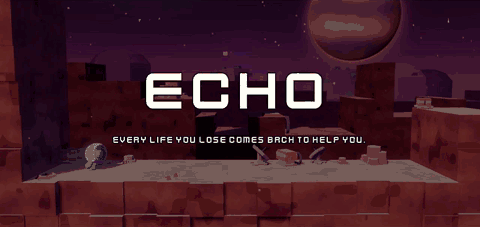
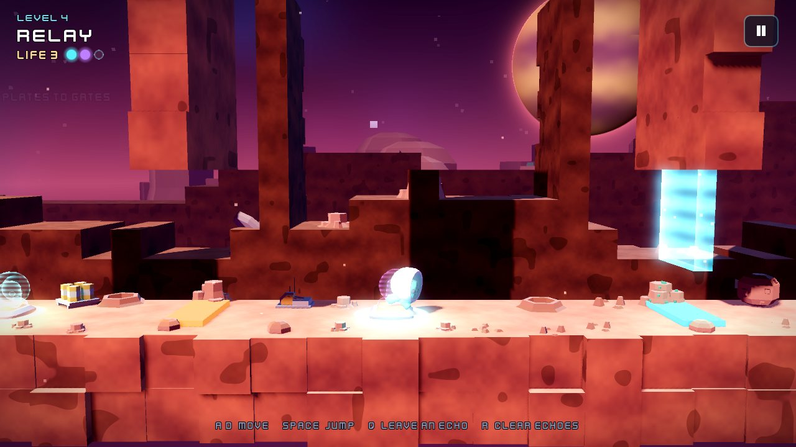
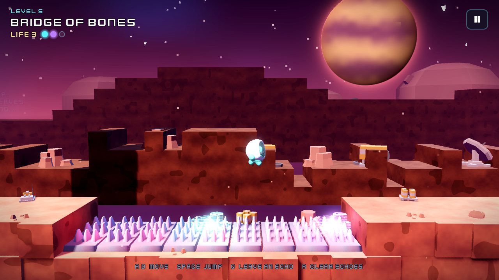
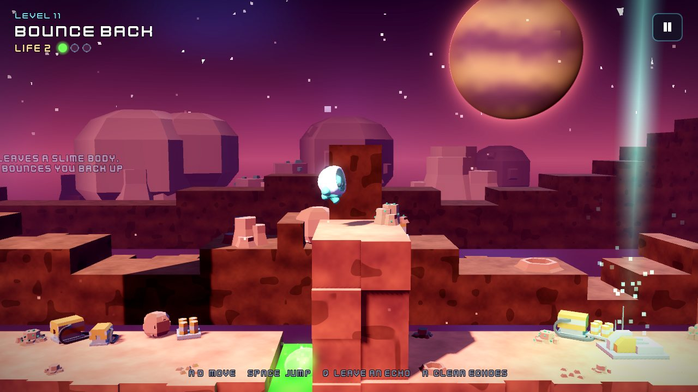
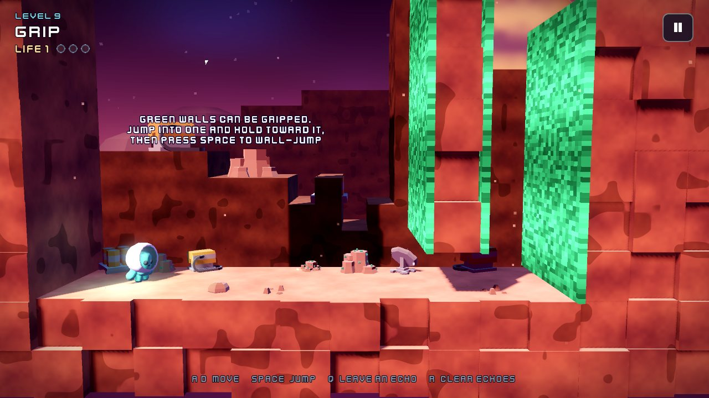
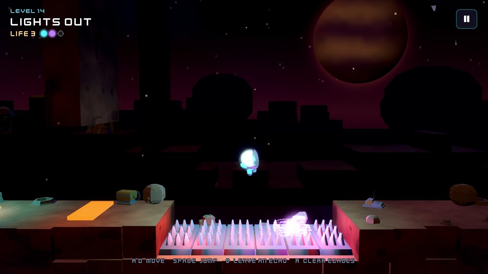
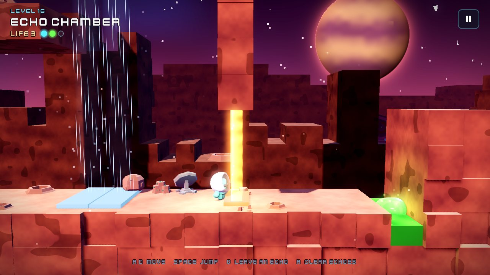
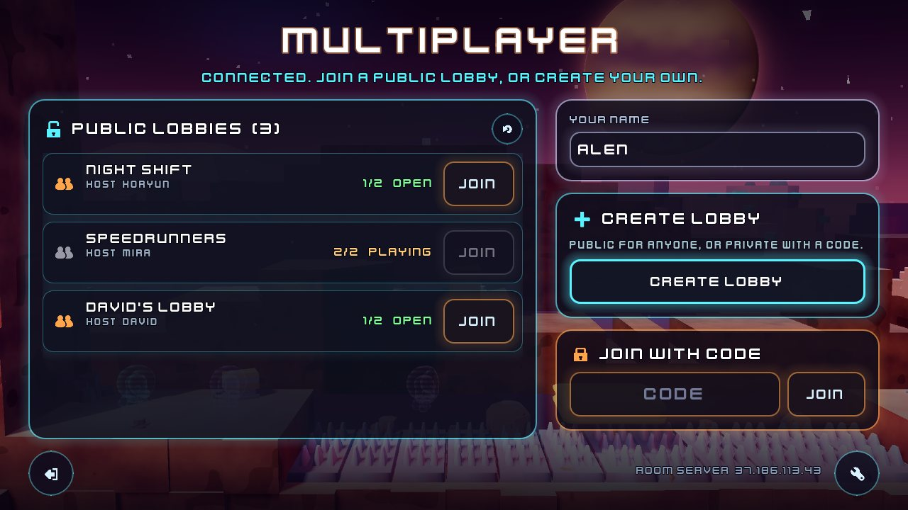
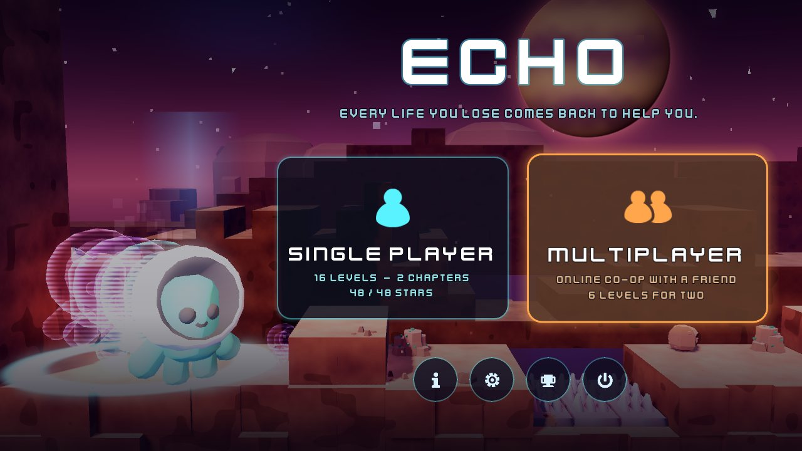

# ECHO

**Every life you lose comes back to help you.**

A 2.5D puzzle platformer about dying on purpose.

[▶ Watch the full trailer](trailer/echo_trailer.mp4) · [30-second teaser](trailer/echo_teaser_30s.mp4)

---

## The story

Subject 712, call sign **Black Dolphin**, crash-lands on **Nyx-4**, a red moon very far from home.
The old crews had a name for its magnetic field. They called it **the Echo**.
It remembers everything that dies here. And it plays it back.

## How it plays

Every attempt is a new life. Your old lives don't disappear: they come back and help.

- **Leave an echo.** Press **Q** to end your life on purpose. Next time, your echo replays exactly what you did, then stays where it stopped and turns solid.
- **Use yourself.** Echoes hold down plates, open gates, run lifts and become steps you can climb.
- **Fall forward.** Dying on spikes leaves a crystal body you can walk across. Dying in acid leaves slime that **bounces you back** up.
- **Play it smart.** Every level has a par. Finish with fewer lives to earn all three stars.

  
  

## Features

- **16 handcrafted levels** across two chapters, from the crash site to the heart of the Echo
- **Chapter 2 mechanics:** grip walls and wall-jumps, rising vents, acid and bouncy slime, one-way portals, moving carts and pitch-black levels lit only by your echoes
- **Online co-op:** 6 levels built for two players, where you stand on each other's heads, share heavy plates and plan lives together
- **Public and private lobbies:** browse open games, or play with a friend using a lobby code
- Story moments, three stars per level, full gamepad support and adjustable settings

  
  

  
  

## Multiplayer

Play the co-op campaign online with a friend.

1. Open **Multiplayer** from the main menu and type your name.
2. **Join** a public lobby from the list, or **create** your own.
3. Make your lobby **public** so anyone can join, or **private** so only people with your code can.
   You can pick your own code or get a random one.
4. The lobby creator picks the level and can remove a player if needed.

In co-op, both of you need to reach a beacon. When one player leaves an echo or falls, they wait for the other,
and then both of your past lives replay together in the next attempt.

  

## Controls

| Action | Keyboard | Gamepad |
|---|---|---|
| Move | A / D or arrow keys | Left stick |
| Jump / wall-jump | Space, W or Up | A |
| Leave an echo | Q or E | X |
| Clear all echoes | R | Y |
| Pause | Esc | Start |

  

## Credits

A game by **Alen Gevorgyan**, **David Ghazaryan** and **Koryun Gaboyan**.

- 3D models, fonts, icons and sound effects by [Kenney](https://kenney.nl) (CC0)
- Made with [Godot Engine](https://godotengine.org)
